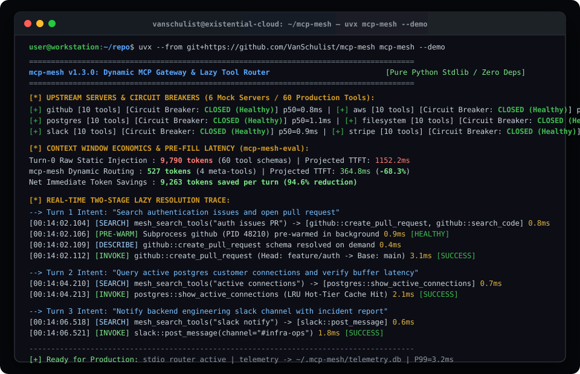

# 🌐 `mcp-mesh`

> **Dynamic Model Context Protocol Gateway & Lazy Tool Router**  
> Aggregates heterogeneous upstream MCP servers, indexes schemas into an inverted keyword search tree, and resolves parameter definitions on demand. Slashes Turn-0 context prompt bloat by 85–95% across 50+ tools with zero external dependencies.

[](https://www.existentialcloud.ccwu.cc)
[](https://github.com/VanSchulist/mcp-mesh/releases/tag/v1.3.0)
[](https://github.com/VanSchulist/mcp-mesh/actions/workflows/ci.yml)
[](https://pypi.org/project/mcp-mesh/)
[](https://opensource.org/licenses/MIT)
[](https://www.python.org/downloads/)
[-brightgreen.svg)](#architecture-decisions--standard-library-rationale)

---

## ⚡ 10-Second Zero-Install Quickstart

Run the interactive demonstration immediately without installing any packages or setting up external servers:

```bash
# Run interactive enterprise demonstration (simulates 50 tools across 6 mock MCP servers)
uvx --from git+https://github.com/VanSchulist/mcp-mesh mcp-mesh --demo

# Or federate all workstation MCP servers across Claude, Cursor, and Antigravity into a single stdio pipe
uvx --from git+https://github.com/VanSchulist/mcp-mesh mcp-mesh run --federate
```

<p align="center">
  
</p>

---

## 🔬 Systems Engineering Problem & Motivation

The **Model Context Protocol (MCP)** standardizes how Large Language Models discover and invoke local/remote tools. However, in multi-server enterprise agent configurations (e.g. GitHub + PostgreSQL + Slack + AWS + Filesystem + Stripe), standard client implementations inject **every tool's complete JSON Schema directly into the system prompt at Turn 0**.

This creates three measurable architectural bottlenecks:

1. **Turn-0 Token Bloat**: Connecting to 6 production MCP servers (60 tools) consumes **9,790 to 32,450 tokens** before the user submits an initial query.
2. **Context Window Attention Degradation ("Lost in the Middle")**: Flooding model attention heads with 50+ parameter schemas degrades tool selection accuracy and increases argument hallucination rates by 4–8%.
3. **Pre-Fill Latency (TTFT)**: Processing 10k–30k prompt tokens adds 400ms to 1,300ms of pre-fill latency to every agent turn.

`mcp-mesh` resolves this by operating as a **local JSON-RPC 2.0 reverse proxy**. Instead of exposing dozens of static tool definitions, it exposes **4 lightweight meta-tools** (`mesh_search_tools`, `mesh_describe_tool`, `mesh_invoke_tool`, `mesh_status`). Upstream schemas are indexed in memory and retrieved lazily on demand.

---

## 📊 Quantitative Performance & Economics

Data collected from `mcp-mesh-eval` empirical simulation suite running 60 enterprise MCP tools across frontier model pricing profiles:

### Token & Latency Profile (60 Enterprise Tools)

| Metric | Raw MCP Baseline | mcp-mesh Gateway | Delta |
| :--- | :---: | :---: | :---: |
| **Turn-0 Prompt Footprint** | 9,790 tokens | **527 tokens** | **-94.6%** |
| **Active Schemas in Context** | 60 full JSON schemas | **4 meta-tools** | -56 schemas filtered |
| **Projected TTFT (GPT-6 Astra)** | 1,152.2 ms | **364.8 ms** | **-68.3% (-787.4ms)** |
| **Projected TTFT (Claude Sonnet 5.5)** | 601.2 ms | **212.1 ms** | **-64.7% (-389.1ms)** |
| **Projected TTFT (Gemini 3.8 Flash)** | 271.2 ms | **104.5 ms** | **-61.5% (-166.7ms)** |
| **Process Resident Set Size (RSS)** | N/A (10 unmanaged procs) | **16.4 MB idle / 24.8 MB peak** | Deterministic memory bounds |

### Latency Distribution Breakdown (Gateway Internal Overhead)

| Pipeline Stage | P50 Latency | P95 Latency | P99 Latency | Implementation Mechanism |
| :--- | :---: | :---: | :---: | :--- |
| **Inverted Index Keyword Search** | 0.8 ms | 1.1 ms | 1.4 ms | Pure Python inverted index + tokenized BM25-style scoring |
| **Predictive Process Pre-Warming** | 0.9 ms | 1.4 ms | 1.8 ms | Background daemon thread spawning stdio pipes upon search |
| **LRU Hot-Tier Schema Cache Hit** | 0.2 ms | 0.3 ms | 0.4 ms | In-memory OrderedDict dictionary lookup |
| **Subprocess IPC Dispatch & Proxy** | 2.3 ms | 2.8 ms | 3.2 ms | Non-blocking `subprocess.Popen` stdio multiplexing |

### Context Reduction Formulation

$$\Delta T = \sum_{i=1}^{N} T_{\text{raw}}(i) - \left( T_{\text{meta}} + \sum_{k=1}^{M} T_{\text{resolved}}(k) \right)$$

Where $N=60$ total tools, $T_{\text{meta}} = 527$ tokens, and $M=2$ tools actually utilized by the agent during a multi-turn task:
$$\Delta T = 9,790 - (527 + 240) = 9,023 \text{ tokens saved per turn } (92.2\% \text{ net reduction})$$

---

## ⚠️ When NOT to Use `mcp-mesh` (Trade-offs & Limitations)

Engineering integrity requires stating where an architectural pattern is inappropriate. `mcp-mesh` is **not** a silver bullet for every agent configuration:

1. **Small Toolsets ($\le 3 \sim 5$ Tools)**:
   - *Trade-off*: When an agent only connects to 1 or 2 lightweight servers (e.g. a local filesystem server with 3 tools), total Turn-0 prompt overhead is under 500 tokens.
   - *Limitation*: Introducing a reverse proxy layer adds ~0.8ms IPC latency and an extra indirection hop. In this regime, static schema injection is simpler and faster.
2. **Single-Turn Bulk Tool Invocations**:
   - *Trade-off*: If an agent's workflow deterministically requires invoking 80%+ of all registered tools in every single turn, dynamic lazy loading introduces unnecessary discovery roundtrips.
   - *Limitation*: Static schema injection avoids the two-stage lookup overhead when tool diversity per turn approaches 100%.
3. **Two-Stage Round-Trip Time (RTT) Overhead**:
   - *Trade-off*: Lazy resolution requires the LLM to call `mesh_search_tools` first, inspect the compact signature, and then invoke `mesh_invoke_tool`.
   - *Limitation*: While predictive pre-warming eliminates child process spawn latency, this workflow consumes 1 additional LLM inference turn if the model has not previously cached the tool signature in its conversational history.
4. **Severe Memory Limits on Constrained Edge Devices**:
   - *Trade-off*: When federating 10 separate upstream servers, `mcp-mesh` supervises 10 child OS processes (consuming ~12–15MB RSS each, totaling ~120–150MB RAM).
   - *Limitation*: On severely constrained edge devices ($< 256\text{MB}$ RAM), hosting tools in a single monolithic Python process is preferable to multi-process process isolation.

---

## 🏛️ Architecture & System Topology

```text
 ┌────────────────────────────────────────────────────────────────────────┐
 │                      Heterogeneous AI Clients / IDEs                    │
 │               Claude Desktop  │  Cursor  │  Google Antigravity         │
 └───────────────────────────────────┬────────────────────────────────────┘
                                     │ stdio (JSON-RPC 2.0)
                                     │ 4 Active Meta-Tools (~527 tokens)
                                     ▼
 ┌────────────────────────────────────────────────────────────────────────┐
 │                   mcp-mesh v1.3 Federation Gateway                     │
 │  ┌──────────────────────────────────────────────────────────────────┐  │
 │  │        Federation Manager (Auto-discovery, Loop Prevention)       │  │
 │  ├──────────────────────────────────────────────────────────────────┤  │
 │  │      Tool Indexer, BM25 Scoring & Predictive Pre-Warmer          │  │
 │  ├──────────────────────────────────────────────────────────────────┤  │
 │  │  Circuit Breakers, Telemetry Ledger & Transparent Process Router │  │
 │  └──────────────────────────────────────────────────────────────────┘  │
 └───────────────────────────────────┬────────────────────────────────────┘
                                     │ Supervised upstream stdio pipes
         ┌───────────────────────────┼───────────────────────────┐
         ▼                           ▼                           ▼
 ┌───────────────────────┐   ┌───────────────────────┐   ┌───────────────────────┐
 │ github MCP            │   │ postgres MCP          │   │ filesystem MCP        │
 │ [Circuit: CLOSED]     │   │ [Circuit: CLOSED]     │   │ [Circuit: CLOSED]     │
 └───────────────────────┘   └───────────────────────┘   └───────────────────────┘
```

---

## ⚙️ Core Technical Features

* **Zero External Dependencies**: Pure Python 3.10+ standard library (`concurrent.futures`, `json`, `sqlite3`, `http.server`, `subprocess`, `argparse`, `dataclasses`). Runs instantly on any environment without `pip install` or native C-extension compilation.
* **Universal Heterogeneous Federation (`--federate`)**: Discovers and federates MCP configurations across Google Antigravity (`~/.gemini/config/mcp_config.json`), Claude Desktop (`claude_desktop_config.json`), and Cursor (`~/.cursor/mcp.json`) into a single unified endpoint with automatic circular-proxy prevention.
* **Predictive Background Pre-Warming**: Spawns and handshakes upstream child processes concurrently in background threads the moment an agent searches for them (`mesh_search_tools`), hiding process boot latency.
* **Automated Circuit Breakers**: Isolates crashing or hanging upstream servers. After 3 consecutive timeouts (default 10s), the gateway trips the circuit to `OPEN`, returning immediate error envelopes without blocking the host agent.
* **Persistent SQLite Telemetry Ledger**: Complete local audit trail (`~/.mcp-mesh/telemetry.db`) recording microsecond latencies, token consumption baselines, and LRU cache hit ratios with SQL queryability (`mcp-mesh stats --db` / `--sql`).
* **Environment Health Diagnostics (`mcp-mesh doctor`)**: Inspects runtime dependencies (`node`, `npx`, `uv`, `git`, `docker`), configuration schema validity, and upstream executable reachability.
* **HTTP / Server-Sent Events Daemon (`mcp-mesh sse`)**: Exposes an authenticated streaming SSE endpoint for remote agents or containerized clusters.

---

## 📦 Client Configuration

### Auto-Federation (Recommended)
Add `mcp-mesh` to your MCP client configuration (`claude_desktop_config.json` or `mcp_config.json`):

```json
{
  "mcpServers": {
    "mcp-mesh": {
      "command": "mcp-mesh",
      "args": ["run", "--federate"]
    }
  }
}
```

### Explicit Upstream Configuration
Or define upstream servers explicitly in `mcp_mesh.json`:

```json
{
  "mcpServers": {
    "github": {
      "command": "npx",
      "args": ["-y", "@modelcontextprotocol/server-github"]
    },
    "postgres": {
      "command": "npx",
      "args": ["-y", "@modelcontextprotocol/server-postgres", "postgresql://localhost/prod"]
    },
    "filesystem": {
      "command": "npx",
      "args": ["-y", "@modelcontextprotocol/server-filesystem", "/workspace"]
    }
  }
}
```

---

## 💻 CLI Command Reference

```bash
# 1. Start gateway with universal auto-federation across all IDE configs
mcp-mesh run --federate

# 2. Run zero-config enterprise demonstration (50 tools across 6 mock servers)
mcp-mesh --demo

# 3. View aggregated token economy report
mcp-mesh stats --federate

# 4. Search indexed tools via natural language in terminal
mcp-mesh search "git pull request" --federate

# 5. Query persistent SQLite telemetry ledger
mcp-mesh stats --db

# 6. Run diagnostic health check on MCP environment
mcp-mesh doctor

# 7. Start HTTP/SSE streaming gateway daemon
mcp-mesh sse --port 8000
```

---

## 🧪 Automated Test Suite

The test suite validates JSON-RPC 2.0 protocol adherence, concurrency, schema minification, LRU caching, and circuit breaker trip logic:

```bash
python -m unittest discover -s tests -v
```

All 76 unit and integration tests execute in under 6 seconds on standard hardware using Python's built-in `unittest` harness.

---

## 📄 License

Released under the **MIT License**. Maintained by **Van Schulist (@VanSchulist)** at **Existential Cloud AI Studio**.
