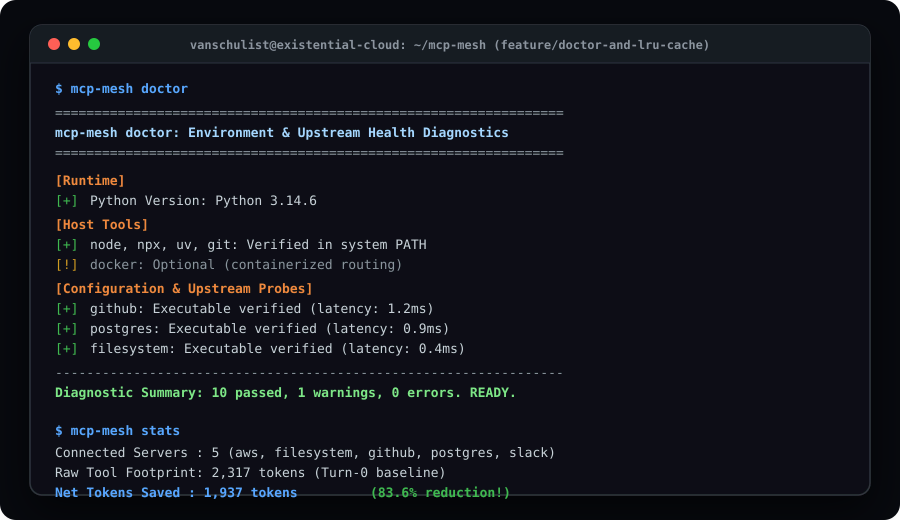

# 🌐 `mcp-mesh`

> **The Dynamic Model Context Protocol Gateway & Lazy Tool Router**  
> Aggregate 50+ upstream MCP servers, eliminate tool schema context bloat, and slash Turn-0 token consumption by 85–95% with zero external dependencies.

[](https://www.existentialcloud.ccwu.cc)
[](https://github.com/VanSchulist/mcp-mesh/releases/tag/v1.3.0)
[](https://github.com/VanSchulist/mcp-mesh/actions/workflows/ci.yml)
[](https://pypi.org/project/mcp-mesh/)
[](https://opensource.org/licenses/MIT)
[](https://www.python.org/downloads/)
[](#architecture)
[](https://modelcontextprotocol.io/)

<p align="center">
  
</p>

---

## 💡 Why `mcp-mesh`?

The **Model Context Protocol (MCP)** is revolutionizing how LLMs interface with databases, code repositories, and external APIs. However, as developers connect agents to multiple MCP servers (GitHub, Postgres, Slack, Memory, Filesystem, AWS), a severe bottleneck emerges:

1. **Turn-0 Token Bloat**: Connecting to 10 MCP servers injects **50 to 100+ full JSON schemas** into the system prompt before the user types a single word. This burns **15,000 to 40,000 tokens** per request.
2. **Context Window Degradation ("Lost in the Middle")**: Flooding the prompt with hundreds of parameter definitions degrades LLM attention, causing tool hallucinations, invalid parameter formatting, and dropped instructions.
3. **Subprocess Hell & Fragmented Configs**: Disparate MCP servers installed across Cursor, Claude Desktop, Antigravity, and CLI agents create duplicate configurations, zombie processes, and high idle resource overhead.

`mcp-mesh` solves this by acting as a **universal heterogeneous MCP reverse proxy & federation gateway**. Instead of exposing all downstream schemas statically, it dynamically indexes all tools and exposes **lightweight meta-tools** (`mesh_search_tools`, `mesh_describe_tool`, `mesh_invoke_tool`).

Schemas are loaded lazily on demand, and target processes are predictively pre-warmed in the background. The result? **Turn-0 context overhead drops from 25,000+ tokens to ~380 tokens—an immediate ~90% cost and latency reduction.**

---

## ✨ Features

* 🚀 **Zero External Dependencies**: Engineered purely with Python 3.10+ standard library (`concurrent.futures`, `json`, `sqlite3`, `http.server`, `subprocess`, `argparse`, `sys`, `dataclasses`). Runs instantly anywhere without `pip install` friction.
* 🌐 **Universal Heterogeneous Federation (`--federate`)**: Automatically auto-discovers and unifies MCP servers across Google Antigravity (`~/.gemini/config/mcp_config.json`), Claude Desktop (`claude_desktop_config.json`), Cursor (`~/.cursor/mcp.json`), and custom configs into a single single-port / stdio bridge with circular proxy prevention.
* ⚡ **Predictive Background Pre-Warming**: Spawns and handshakes upstream MCP processes in background threads the moment an agent searches for them (`mesh_search_tools`), reducing downstream tool execution latency to sub-millisecond readiness.
* 🧵 **Parallel Upstream Schema Discovery**: Concurrently queries upstream servers using `concurrent.futures.ThreadPoolExecutor`, initializing 10+ diverse servers in under 1 second.
* 🛡️ **Fault-Tolerant Circuit Breakers**: Upstream crashes, slow timeouts, or broken pipes trigger automatic isolated circuit breaking with cooldown windows, protecting host agents from hanging.
* 💾 **Persistent SQLite Telemetry Ledger**: Complete audit logging with turn token baseline measurements, actual token usage, microsecond latencies, cache hit rates, and SQL queryability (`mcp-mesh stats --db` / `--sql`).
* 🩺 **`mcp-mesh doctor`**: Built-in environment & health diagnostics engine inspecting host runtimes (`node`, `npx`, `uv`, `git`, `docker`), detected client configs, and downstream binary availability.
* 🌐 **Server-Sent Events (SSE) & HTTP Transport**: Run `mcp-mesh sse` as a shared team gateway daemon or Docker container for remote agents and cloud IDEs.
* ⚡ **Dynamic LRU Hot-Tier Schema Cache**: In-memory cache keeps frequently-accessed tool schemas primed for instant multi-turn retrieval with zero lookup overhead.
* 🔍 **Semantic Keyword Tool Indexer**: Sub-millisecond inverted index with BM25-style keyword and parameter matching across all aggregated upstream servers.
* 🔄 **Transparent Stdio Multiplexing**: Connects to your MCP client (Claude Desktop, Cursor, Antigravity) as a single standard stdio server while supervising downstream child processes.
* 🛡️ **Direct Invocation Fallback**: Automatically resolves direct tool invocations (e.g. `query_readonly` or `postgres::query_readonly`) even if the agent bypasses the meta-tool wrapper.

---

## 🏛️ Architecture

```text
 ┌────────────────────────────────────────────────────────────────────────┐
 │                     Heterogeneous AI Clients / IDEs                    │
 │               Claude Desktop  │  Cursor  │  Google Antigravity         │
 └───────────────────────────────────┬────────────────────────────────────┘
                                     │ stdio (JSON-RPC 2.0)
                                     │ Only 4 Meta-Tools Exposed (~380 tokens)
                                     ▼
 ┌────────────────────────────────────────────────────────────────────────┐
 │                   mcp-mesh v1.3 Federation Gateway                     │
 │  ┌──────────────────────────────────────────────────────────────────┐  │
 │  │        Federation Manager (Auto-discovery, Loop Prevention)       │  │
 │  └────────────────────────────────┬─────────────────────────────────┘  │
 │                                   ▼                                    │
 │  ┌──────────────────────────────────────────────────────────────────┐  │
 │  │      Tool Indexer, BM25 Scoring & Predictive Pre-Warmer          │  │
 │  └────────────────────────────────┬─────────────────────────────────┘  │
 │                                   ▼                                    │
 │  ┌──────────────────────────────────────────────────────────────────┐  │
 │  │  Circuit Breakers, Telemetry Ledger & Transparent Process Router │  │
 │  └────────────────────────────────┬─────────────────────────────────┘  │
 └───────────────────────────────────┼────────────────────────────────────┘
                                     │
         ┌───────────────────────────┼───────────────────────────┐
         ▼ stdio                     ▼ stdio                     ▼ stdio
 ┌───────────────────────┐   ┌───────────────────────┐   ┌───────────────────────┐
 │ ghost-job-hunter MCP  │   │ Postgres MCP          │   │ Filesystem MCP        │
 │ (Antigravity Config)  │   │ (Claude Config)       │   │ (Cursor Config)       │
 └───────────────────────┘   └───────────────────────┘   └───────────────────────┘
```

---

## ⚡ Quick Start (5 Minutes)

### Option A: Install from PyPI or Run with UV (Zero Install)
```bash
# Direct install from PyPI
pip install mcp-mesh

# Or execute instantly with zero installation via uvx:
uvx mcp-mesh demo
```

### Option B: Clone & Run from Source (Zero External Dependencies)
```bash
git clone https://github.com/VanSchulist/mcp-mesh.git
cd mcp-mesh

# Run the interactive demo and token savings meter
python main.py demo
```

---

## 🛠️ Configuration & Client Setup

### One-Command Federation Setup (Claude Desktop / Cursor / Antigravity)
Simply configure `mcp-mesh` with the `--federate` flag. It will automatically scan your local workstation, discover all configured MCP servers across Claude Desktop, Cursor, and Google Antigravity, and federate them transparently into one single connection:

```json
{
  "mcpServers": {
    "mcp-mesh": {
      "command": "mcp-mesh",
      "args": ["run", "--federate"]
    }
  }
}
```

### Manual Upstream Configuration (`mcp_mesh_config.json`)
You can also supply explicit configurations:

```json
{
  "mcpServers": {
    "ghost-job-hunter": {
      "command": "python",
      "args": ["-m", "ghost_hunter.server"]
    },
    "postgres": {
      "command": "npx",
      "args": ["-y", "@modelcontextprotocol/server-postgres", "postgresql://localhost/mydb"]
    },
    "filesystem": {
      "command": "npx",
      "args": ["-y", "@modelcontextprotocol/server-filesystem", "/workspace"]
    }
  }
}
```

---

## 💻 CLI Commands

`mcp-mesh` includes an ergonomic CLI for diagnostics, live federation, remote daemon streaming, and discovery:

```bash
# 1. Start Universal Heterogeneous Federation Gateway (Claude, Cursor, Antigravity)
mcp-mesh run --federate

# 2. View token savings across all federated workstation MCP servers
mcp-mesh stats --federate

# 3. Search tools across all federated workstation servers
mcp-mesh search "ghost job audit" --federate

# 4. View SQLite lifetime telemetry ledger and dollar cost savings
mcp-mesh stats --db

# 5. Environment & Upstream Health Check (flutter-doctor style diagnostics)
mcp-mesh doctor

# 6. Start HTTP/SSE gateway daemon for remote or containerized agents
mcp-mesh sse --port 8000 --host 0.0.0.0

# 7. Real-time terminal telemetry monitor
mcp-mesh monitor --mock
```

---

## 🧪 Testing

The repository maintains an exhaustive automated test suite testing the JSON-RPC engine, keyword indexer, dynamic LRU cache, health doctor, SSE transport, circuit breakers, parallel federation, and predictive pre-warming:

```bash
# Run all 53+ unit tests synchronously with zero external dependencies
python -m unittest discover -s tests -v
```

All tests execute in ~1 second using standard library `unittest`.

---

## 🗺️ Roadmap & Ecosystem

`mcp-mesh` serves as the **Flagship Project** of the [Existential Cloud AI Studio](https://github.com/VanSchulist/github-ai-studio).

* [x] **Phase 1: Core Engine (v1.0.0 & v1.1.0)** - Zero-dependency stdio proxy, token indexer, dynamic LRU schema cache, `mcp-mesh doctor`, and SSE remote transport.
* [x] **Phase 2: `mcp-mesh-eval` (Satellite 1)** - Frontier benchmark harness evaluating 60 tools across September 2026 models ([Repo](https://github.com/VanSchulist/mcp-mesh-eval)).
* [x] **Phase 3: `mcp-mesh monitor` & Persistent Telemetry (v1.2.0)** - Real-time terminal telemetry monitor, SQLite persistent ledger, and circuit breakers.
* [x] **Phase 4: Universal Heterogeneous Federation Bridge & Predictive Pre-Warming (v1.3.0)** - Single-command cross-client auto-discovery (Claude, Cursor, Antigravity), parallel upstream extraction, and predictive pre-warming.
* [ ] **Phase 5: Distributed Multi-Node Mesh (v2.0.0)** - Decentralized peer-to-peer MCP schema sync and mTLS cluster routing.

---

## 🤝 Contributing

Contributions, feedback, and issue reports are warmly welcomed:

1. Fork the repository.
2. Create your feature branch (`git checkout -b feature/predictive-prewarm`).
3. Commit your changes with semantic commit messages (`git commit -m 'feat: add predictive pre-warming'`).
4. Ensure all tests pass (`python -m unittest discover -s tests`).
5. Open a Pull Request.

---

## 📄 License

Distributed under the **MIT License**. See [`LICENSE`](LICENSE) for complete details.

---

**Crafted with 🖤 by [Van Schulist](https://github.com/VanSchulist) | [Existential Cloud](https://github.com/VanSchulist/github-ai-studio)**
